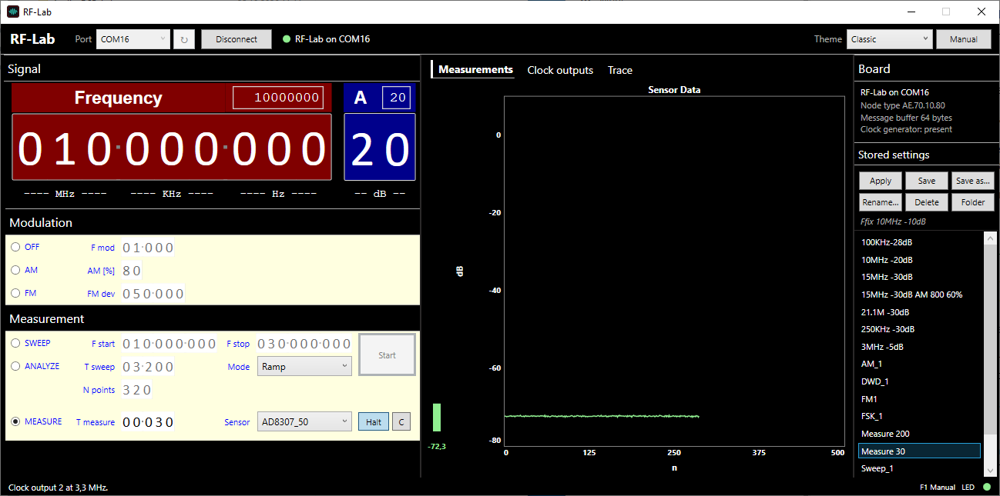

# RF-Lab

A small RF laboratory on a PC: a DDS signal generator from 100 kHz to 300 MHz
with AM, FM and frequency sweeps, a scalar response analyser, a level meter
with an AD8307 log detector, and three Si5351 clock outputs — on an Arduino
Mega 2560 with the GRA & AFCH AD9910 DDS shield, operated from a Windows
application over USB.

RF-Lab is the standalone form of the RF-MiniLab instrument of the HASE
laboratory system. It uses the same board and the same firmware: a board
flashed for one works with the other, without reflashing.

## What it does

| | |
|---|---|
| Carrier | 100 kHz – 300 MHz, 1 Hz steps, attenuation 0 – 75 dB below full scale |
| AM | modulation 1 Hz – 99 999 Hz, depth 0 – 99 % |
| FM | modulation 1 Hz – 99 999 Hz, deviation up to 999 999 Hz |
| SWEEP | the AD9910's own sweep: bidirectional, ramp or single ramp, 1 ms – 16 s |
| ANALYZE | steps the carrier across a span and reads the detector at each point: a scalar response over frequency |
| MEASURE | reads the detector every 10 ms to 16 s and plots the level (dB) or the detector voltage (mV) |
| Clock outputs | three Si5351 outputs, 10 kHz – 160 MHz each |
| Stored settings | the original RF-Lab files: load, save, save as, rename, delete |
| Trace | every MCNF frame to and from the board, timed |
| Themes | Classic (the original look), Studio dark, Studio light |

## Getting started

1. Download `RF-Lab-<version>-windows-x64.zip` from the
   [releases](https://github.com/andiepp/RF-Lab/releases) and unpack it.
2. Connect the board by USB and start `RfLab.exe`. Choose its COM port and
   click **Connect**. The board restarts when the port opens (about three
   seconds); then the window's setting is sent to it.
3. If the board does not answer as an RF-Lab board, flash the firmware:
   `firmware\Flash-Firmware.cmd` (it needs avrdude, which comes with the
   Arduino IDE).

The [manual](docs/Manual.md) describes the hardware, every control and the
stored-setting files; **Manual** (or F1) in the application opens it as a PDF.
The board can also be driven without the application: see
[docs/Protocol.md](docs/Protocol.md) and the Python client
[tools/rflab.py](tools/rflab.py).

## Repository

| Folder | Contents |
|---|---|
| `app/` | the Windows application (.NET 10, WPF): `RfLab.Core` (MCNF protocol, board client, stored settings), `RfLab` (the window), tests |
| `firmware/` | the board firmware (Arduino Mega 2560) and the libraries it needs that the Arduino library index does not carry |
| `presets/` | example stored settings, copied to `%LocalAppData%\RF-Lab\Presets` at the first start |
| `docs/` | manual, protocol, building |
| `tools/` | release build, firmware flashing, the Python client, screenshot and icon helpers |

Building from source: [docs/Building.md](docs/Building.md).

## Licence

The application and the tools: MIT, see [LICENSE](LICENSE). The firmware
is GPL (its own header, and the GPL-3 libraries it links); it contains code
by GRA & AFCH. See [THIRD-PARTY-NOTICES.md](THIRD-PARTY-NOTICES.md).
