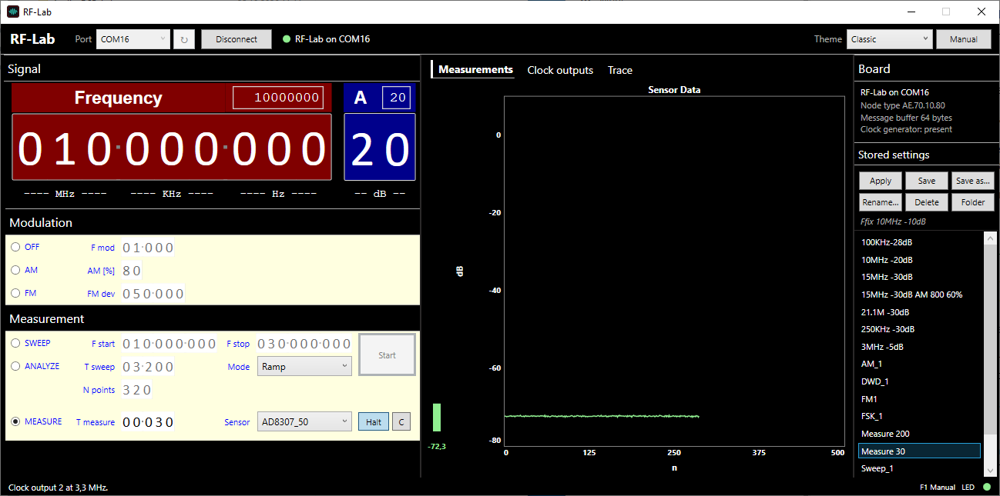
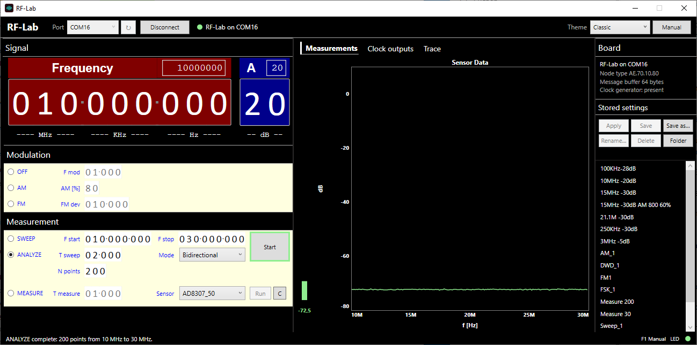
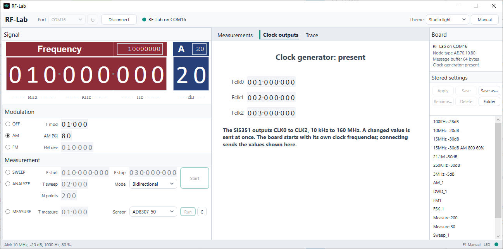
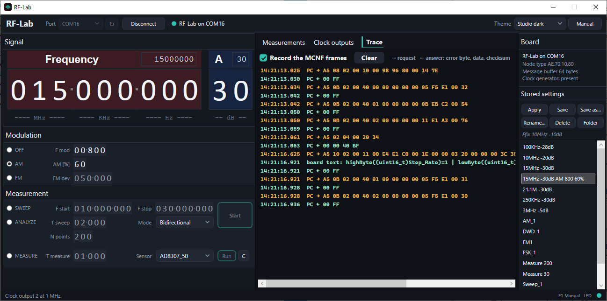

# RF-Lab Manual

As of 2026-11-03 · application 1.0 · firmware 1.0

RF-Lab turns an Arduino Mega 2560 with the GRA & AFCH AD9910 DDS shield into
a small RF laboratory operated from a Windows PC: a signal generator with AM,
FM and sweeps, a scalar response analyser, a level meter and three clock
outputs.

## Introduction

### What RF-Lab is

The board generates the signals; the PC application sets them. The board
keeps no readable signal state: the application holds every value shown in
its window and sends the whole setting whenever one value changes. The
board reports what it can report: its identity, whether its clock generator
is fitted, its LED and its detector input.

RF-Lab is the standalone form of the RF-MiniLab instrument of the HASE
laboratory system. Board and firmware are the same: a board flashed for one
works with the other without reflashing (see "Using the board with HASE").

### The hardware

| Part | Purpose |
|---|---|
| Arduino Mega 2560 | controller; USB serial port to the PC (115200 baud) |
| AD9910 DDS V3 shield (GRA & AFCH) | the signal: 100 kHz – 300 MHz, 50 MHz TCXO, AM, FM and sweeps in the DDS itself |
| Si5351 clock generator (I²C) | three square-wave clock outputs, 10 kHz – 160 MHz |
| AD8307 log detector, 50 Ω input | the level meter: about -70 to +10 dB, read by the Mega's converter (input A8, 2.56 V reference) |
| 128×64 OLED (I²C) | shows the board's own state |
| +5 V probe output | supply for high-impedance probes ahead of the detector |

The signal leaves the board at the shield's RF output. Connect the device
under test between the RF output and the detector input to measure a
response (ANALYZE), or the detector alone to measure a level (MEASURE).

### Ranges

| Setting | Range |
|---|---|
| Carrier frequency | 100 kHz – 300 MHz, 1 Hz steps |
| Attenuation | 0 – 75 dB below full scale |
| AM | modulation 1 – 99 999 Hz, depth 0 – 99 % |
| FM | modulation 1 – 99 999 Hz, deviation 1 – 999 999 Hz |
| Sweep | start and stop 100 kHz – 300 MHz, 1 – 16 000 ms |
| ANALYZE | 10 – 500 points |
| MEASURE | one reading every 10 – 16 000 ms |
| Clock outputs | 10 kHz – 160 MHz each |

## Installation

### The application

Unpack `RF-Lab-<version>-windows-x64.zip` anywhere and start `RfLab.exe`.
It is a single program for Windows 10 and 11 (x64) and needs no .NET
installation. It keeps its own files in `%LocalAppData%\RF-Lab`:

| File | Contents |
|---|---|
| `preferences.txt` | the theme and the last serial port |
| `Presets\` | the stored settings; the examples from the zip's `presets` folder are copied here at the first start |
| `RF-Lab Manual.pdf` | this manual, written out when **Manual** is clicked |

To update, replace `RfLab.exe`; the stored settings stay.

### The USB driver

The Mega's USB serial port appears as a COM port. Boards with the CH340
USB chip (most Mega clones) need the CH340 driver, which Windows Update
usually installs by itself. The COM number belongs to the USB socket: plug
the board into another socket and it gets another number.

### The firmware

A board that already serves the HASE RF-MiniLab runs the right firmware.
Otherwise write it with the flash tool from the zip's `firmware` folder:

1. Close the RF-Lab application (and a HASE host using the board): the
   port must be free.
2. Double-click `firmware\Flash-Firmware.cmd` and enter the board's COM
   port, or in PowerShell:

```
.\Flash-Firmware.ps1 -Port COM16
```

The tool uses avrdude, which comes with the Arduino IDE (it finds it in
`%LocalAppData%\Arduino15`); name another one with `-Avrdude`. `-Check`
only asks the bootloader for the chip's signature and writes nothing.
Building the firmware from source is described in `docs/Building.md`.

## The window



### Top bar

- **Port**: the serial ports present; **↻** looks for them again (after
  plugging the board in).
- **Connect** opens the port. The Mega restarts when its port opens, so
  connecting takes about three seconds. The application then checks that an
  RF-Lab board answers (its node type AE.70.10.80), reads whether the clock
  generator is fitted and the LED's state, and sends the window's setting —
  the carrier or modulation and the three clock frequencies — because the
  board restarted on its own defaults.
- **Disconnect** closes the port. The board keeps generating its last
  signal; there is no "output off" command.
- The lamp and text beside the keys show the connection.
- **Theme** switches between Classic, Studio dark and Studio light at once,
  also while connected.
- **Manual** (or F1) opens this manual.

### Signal

The **Frequency** display shows the carrier in Hz, grouped MHz · kHz · Hz;
the **A** display shows the attenuation in dB below full scale. Change a
digit with the mouse wheel over it, or with the small keys that appear above
and below it under the mouse; a carry runs into the next digit. Or type a
number into the field in the display's title and press Enter.

Every change is sent at once in OFF, AM and FM. While a dial turns, the
application sends one request at a time and always the newest value.

### Modulation and measurement

The mode keys on the left choose what the board does: **OFF** (an
unmodulated carrier — "OFF" means modulation off), **AM**, **FM**,
**SWEEP**, **ANALYZE** and **MEASURE**. The fields beside them are enabled
in the modes they belong to. The next chapter describes each mode.

### Measurements, clock outputs, trace

The tabs in the middle show the chart of the measured values with the
current value as a bar on its left, the clock outputs (see "Clock outputs")
and the trace of the board's messages (see "The trace").

### Board and stored settings

The right column shows the connected board: port, node type, message
buffer and whether the Si5351 clock generator is fitted. Below it are the
stored settings (see "Stored settings").

### Status line

The status line reports the last action ("AM: 10 MHz, -20 dB, 1000 Hz,
80 %.") or the last error; an error also lights the red strip at the
window's left edge. The **LED** lamp at the right shows the board's LED as
the board reports it; click it to switch the LED. The LED is a quick test
that the board is listening: it answers with its real state.

## Operating modes

### OFF: the carrier

The board generates the frequency and attenuation of the Signal displays.
Any change is sent at once.

### AM

Amplitude modulation of the carrier with a sine of **F mod** Hz and a depth
of **AM [%]**. The firmware computes the modulation into the AD9910's RAM,
which takes a moment; the AD9910 then plays it by itself.

### FM

Frequency modulation with a sine of **F mod** Hz and a deviation of
**FM dev** Hz, computed into the AD9910's RAM like AM.

### SWEEP

The AD9910's own frequency sweep from **F start** to **F stop** in
**T sweep** ms, at the Signal attenuation. **Mode** chooses its form:

| Mode | Form |
|---|---|
| Bidirectional | up and down again, a triangle |
| Ramp | up, then back to the start at once, a sawtooth |
| SingleRamp | one ramp up; the frequency stays at the stop |

**Start** sends the sweep; the board then sweeps by itself until it gets
another setting. **Stop** sends the carrier again. Choosing SWEEP sends
nothing until Start.

### ANALYZE

A scalar response over frequency: the application steps the carrier from
**F start** to **F stop** in **N points** steps, waits for the detector to
settle, reads it and plots the point. Connect the device under test between
the RF output and the detector.

The settling time per point is **T sweep** divided by the points, with the
original application's floor of 3.2 s for the whole run (the round trip of
a step counts towards it). **Start** begins a run, **Stop** ends it early;
either way the carrier returns to the Signal frequency afterwards.



### MEASURE

The level meter: the application reads the detector every **T measure** ms
and plots the values; the chart starts over after 500 points, **C** clears
it, **Halt** pauses and **Run** continues. The generator keeps its carrier.
**Sensor** chooses the reading:

| Sensor | Reading |
|---|---|
| AD8307_50 | the detector's level in dB (50 Ω input): -(2235 mV − U)/25.917 − 0.5, and -70 below 200 mV |
| AD_8 | the converter input itself in mV, 0 – 2560 |

The chart's dB axis reaches down to -80 dB: a quiet detector input sits at
about 375 mV, which the conversion puts at about -72 dB.

## Clock outputs



The Si5351 has three outputs, **Fclk0** to **Fclk2**, 10 kHz – 160 MHz each.
A changed value is sent at once, to that output only. The board starts with
its own clock frequencies (CLK2 at 25 MHz, for example), so the application
sends the three values shown when it connects. Without a clock generator the
fields stay disabled.

## Stored settings

### Using them

The list shows the files in `%LocalAppData%\RF-Lab\Presets`. A click
selects a setting and shows its description; **Apply** or a double click
loads it into the window and sends it to the board. Values a file does not
carry keep their current value. The setting is sent as a whole, once — not
value by value through intermediate states.

| Key | Action |
|---|---|
| Apply | load the selected setting and send it |
| Save | write the window's values into the selected setting (asks first) |
| Save as… | store the window's values under a new name, with a description |
| Rename… | change the selected setting's name and description |
| Delete | delete the selected setting (asks first; it goes to the recycle bin) |
| Folder | open the folder in Explorer, for copying settings between computers |

### The file format

One setting is one text file, named after the setting, with one `Key,Value`
line per value — the format of the original RF-Lab application, whose files
work unchanged:

```
Name,AM_1
Description,Ffix 10MHz -10dB
Mode,1
Frequency,147500
Amplitude,40
FMod,1000
AMDepth,80
Fdev,50000
SweepMode,Ramp
Sensor,AD8307_50
Fstart,10000000
Fstop,30000000
Tsweep,10000
Tmeasure,500
Nmeasure,500
SI5351Fclk0,1000000
SI5351Fclk1,2000000
SI5351Fclk2,3000000
```

| Key | Meaning |
|---|---|
| Mode | 0 OFF, 1 AM, 2 FM, 3 SWEEP, 4 ANALYZE, 5 MEASURE |
| Frequency, Amplitude | carrier in Hz, attenuation in dB |
| FMod, AMDepth, Fdev | modulation frequency (Hz), AM depth (%), FM deviation (Hz) |
| SweepMode | Bidirectional, Ramp or SingleRamp |
| Sensor | AD8307_50 or AD_8 |
| Fstart, Fstop, Tsweep | sweep span (Hz) and time (ms) |
| Tmeasure, Nmeasure | MEASURE interval (ms), ANALYZE points |
| SI5351Fclk0 … 2 | clock outputs (Hz) |

Keys the application does not use (the original's message generator wrote
`MGENMode`, `Baudrate`, `Pattern` and others) are kept: saving a file keeps
them in their place.

## The trace



The **Trace** tab lists every message to and from the board with its time:
**PC →** a request, **PC ←** the board's answer (error byte, data,
checksum). The firmware prints a few lines of debug text while it prepares
AM and FM; they appear as **board text** and are not part of the answer.
**Record the MCNF frames** pauses the list, **Clear** empties it. The frames
are explained in `docs/Protocol.md`.

## Themes and preferences

**Classic** is the original RF-Lab application's look. **Studio dark** and
**Studio light** are quieter: slate or white surfaces, one teal accent.
The theme and the port are kept in `%LocalAppData%\RF-Lab\preferences.txt`.

`RfLab.exe` also takes arguments, for shortcuts:

| Argument | Effect |
|---|---|
| `--port COM16` | chooses the port |
| `--connect` | connects at start |
| `--theme "Studio dark"` | chooses the theme |

## Scripting the board

The board speaks the MCNF protocol over its serial port; any program can
drive it. `tools/rflab.py` is a Python client (it needs pyserial):

```
python rflab.py COM16 info
python rflab.py COM16 carrier 10000000 20
python rflab.py COM16 am 10000000 20 1000 80
python rflab.py COM16 sensor 10
```

or, as a library:

```
from rflab import RfLab
with RfLab("COM16") as board:
    board.carrier(21_400_000, 40)
    print(board.sensor())
```

`docs/Protocol.md` describes every request byte by byte.

## Troubleshooting

| Symptom | Cause and remedy |
|---|---|
| "No RF-Lab board on COMx: the port is in use by another program" | another program holds the port — a second RF-Lab, a serial terminal or a HASE host. Close it. |
| "… the board did not answer" | the board runs another firmware, or another device is on that port. Check the port; flash the firmware. |
| "The node-type information does not match" | an MCNF board of another kind answers on that port (for example another HASE instrument with the same USB chip). |
| The port is missing | plug the board in, then **↻**. The number follows the USB socket. |
| The detector reads about -72 dB whatever the generator does | the detector sees no signal: check the cable from the RF output to the detector input, and the detector's supply. A quiet AD8307 input sits at about 375 mV. |
| The clock outputs stay disabled | the board reports no Si5351. |
| The connection is closed after an error | a request was sent but no valid answer came back, so the board and the application may no longer agree. Connect again; the window's setting is sent anew. |

## Using the board with HASE

In the HASE laboratory the same board is the RF-MiniLab instrument, served
by a HASE host. Only one program can hold the serial port: stop the HASE
host (or remove the board from its composition) before connecting RF-Lab,
and close RF-Lab before HASE uses the board again. Nothing needs to be
flashed in either direction.

Stored settings are the same files: the HASE panel reads them from
`%LocalAppData%\HASE\Client\Configuration\RfLabPresets`, RF-Lab from
`%LocalAppData%\RF-Lab\Presets`; copy them between the two folders.
